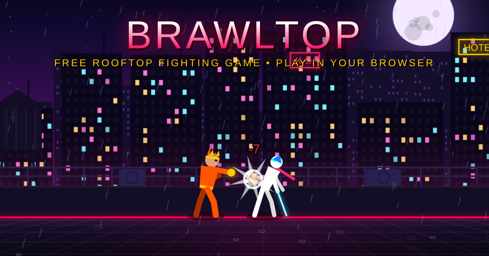

# Brawltop – Free Rooftop Fighting Game

**[▶ Play Brawltop in your browser](https://slickboy414-prog.github.io/The-warriors/)** – free, no download, works on PC, phone and tablet.

Brawltop is a free arcade fighting game built in a single HTML5 file. Fight best-of-3 battles on neon city rooftops as **Pyro**, **Valkyrie** or the unlockable **Titan**. Clear 50 levels against a CPU that plays at human level, survive zombie hordes, earn coins for daily missions and spend them on new weapons and outfits. It also runs as a YouTube Playable.

**Features:** single-player Levels mode (1–50), VS CPU, local 2-player, Supers and Rage mode, signature finishers, a 30-second tutorial, daily missions with streaks, a coin shop, touch controls, and a layout that fits any screen (9:16 on upright phones).

## Controls (PC)

| Action | Player 1 | Player 2 |
|---|---|---|
| Move | A / D | ← / → |
| Jump | W | ↑ |
| Block (hold) | S | ↓ |
| Punch | F | J / Num 1 |
| Kick | G | K / Num 2 |
| Blast (30% meter) | H | L / Num 3 |
| Super (full meter) | T | I / Num 0 |
| Pause | P / Esc | P / Esc |

On phones and tablets, touch controls appear during VS CPU and Levels matches.

**Fits any screen:** the arena takes the shape of the device. Wide phones in landscape get a wider arena with no black bars, tablets and 16:10 laptops get a narrower one, and phones held upright use a 9:16 frame (like YouTube Shorts) with the arena on top and large touch controls underneath. Rotating the device switches the layout instantly. A fight camera zooms in (up to 1.3×) when the fighters are close and pulls back to keep everyone on screen.

## Rules

- Best of 3. Winning rounds 1 and 2 ends the match.
- At 1–1 the Final Round moves to the burning arena, both fighters start with a full Super, and the clock is 60 seconds.

## Levels mode

- 50 single-player levels against the CPU, in five ranks: Rookie, Fighter, Veteran, Elite and Master.
- The CPU improves every level: it blocks more, combos, punishes misses and uses Supers more often.
- It stays at human level: it reacts to what it sees with a delay (never faster than 200 ms), never blocks everything, and still makes mistakes.
- Levels 10, 20, 30 and 40 are bosses: a Shadow fighter in the burning arena, with a little more health.
- **Levels 41–50 are zombie hordes** on a foggy quarantine rooftop. Level 41 has 3 zombies and each level adds one, up to 12 at level 50, where the last one is the Zombie King.
  - Zombies rise from the floor a few at a time (3 on screen, 4 from level 45).
  - A zombie raises its arms and its eyes turn red before it strikes, so you can block. At most 3 attack at once, and after a hit you get a short recovery so the crowd can't stun-lock you.
  - Punches and kicks hit every zombie in reach, and Inferno Wave burns through the whole line. Each kill pays +1 coin.
  - Clear the horde to win the round. If you're K.O.'d, or time runs out with zombies left, you lose the round.
- Stars: 1 for a win, 2 for a 2–0 win, 3 for a 2–0 win finishing both rounds above half health.
- Progress saves automatically (YouTube Playables cloud save, or the browser's local storage).

## Coins and shop

- Earn coins for every round you win: 10 per round, more on higher levels, +5 for a perfect round. Match wins, first-time level clears (+25, or +75 for a boss) and daily missions pay extra.
- Spend coins in the **SHOP** (main menu, level select or results screen). It has **Weapons** and **Attire** tabs and 39 items across the three fighters (6 weapons and 7 outfits each).
- Every item has a rarity: **Common** (free), **Rare**, **Epic** (1,000+ coins) and **Legendary**. Legendary items cost 5,000–6,500 coins *and* need an achievement before they can be bought:
  - Pyro: Sunfire Gauntlets (earn 120 ★), Solar God (7-day mission streak)
  - Valkyrie: Starfall Edge (clear level 50), Seraph (earn 120 ★)
  - Titan: Worldbreaker (earn 140 ★), Ancient King (7-day mission streak)
- **Weapons** look different and give small boosts (up to +3 punch, +2 kick, +3 Blast and extra reach on Legendary weapons).
- **Attire** is cosmetic: new colours plus hoods, capes, crowns, a winged helm, demon horns, fox ears, halos, Phoenix wings or a glowing aura.
- The shop preview shows your fighter wearing whatever you hover or tap. On touch screens, tap once to preview and tap again to buy.
- Coins, purchases and equipped gear save with your level progress. Items bought before a price change stay owned.

## Unlockable fighter: TITAN

Clear all 50 levels to unlock a third fighter. Until then his card on the menu is locked and shows how many levels you have cleared.

- **Stone colossus:** about 30% slower, 115 health, hits 10% harder, and takes half knockback.
- **Blast – QUAKE:** a shockwave that rolls along the floor. Opponents can jump over it.
- **Super – TITAN CRUSH:** leaps at the opponent and slams down for heavy unblockable damage (hits every nearby zombie in zombie levels). Super armour means hits during the leap hurt but don't stop it.
- **Finisher – EARTHSHATTER:** stone spikes erupt around the loser on the match-winning K.O.
- His own shop items: Iron Gauntlets, Obsidian Knuckles, Colossus Mauls, and Jade Giant, Molten Core, Golden Colossus and Void Giant outfits.
- Once unlocked, he can also appear as your CPU opponent in VS CPU, and a "Win rounds as TITAN" daily mission is added.

## Daily missions

- Three new missions every day at midnight (your local time), from a pool of 13: win rounds or matches, win as a specific fighter, use Supers, hit with Blasts, land three-hit combos, block attacks, win a perfect round, win after using Rage, win with a finisher, clear levels, defeat zombies (once the zombie levels are unlocked).
- Coins pay out the moment a mission is completed. Finishing all three pays a bonus that grows with your daily streak: +50 on day 1 up to +110 from day 7.
- One free swap a day for a mission you don't like.
- Missions count in VS CPU and Levels only (not Local 2P or the tutorial), so they can't be farmed.
- Open them with **MISSIONS** on the main menu; the badge shows today's progress (for example 1/3).

## YouTube Playables

The page loads the YouTube Playables SDK and handles pause, resume and the audio toggle. Outside YouTube it runs as a normal web page.

## Improvements from fighting-game research

- **Input buffer:** a button tapped up to 8 frames before you can act is remembered and fires the moment you recover, so fast taps are never lost.
- **Interactive tutorial** (TUTORIAL on the main menu): 8 guided steps against a training dummy covering move, punch, kick, block, Blast, Super, Rage and the finisher. Pays +50 coins the first time; the button shows a NEW badge until you finish it.
- **Rage mode** (R / U / RAGE button): below 30% health, once per round, 8 seconds of +30% damage and +15% speed with a red aura. The CPU uses it too from level 5, reacting faster on harder levels.
- **Signature finishers** on the match-winning K.O.: Pyro's *Phoenix Finish* and Valkyrie's *Thousand Cuts*.
